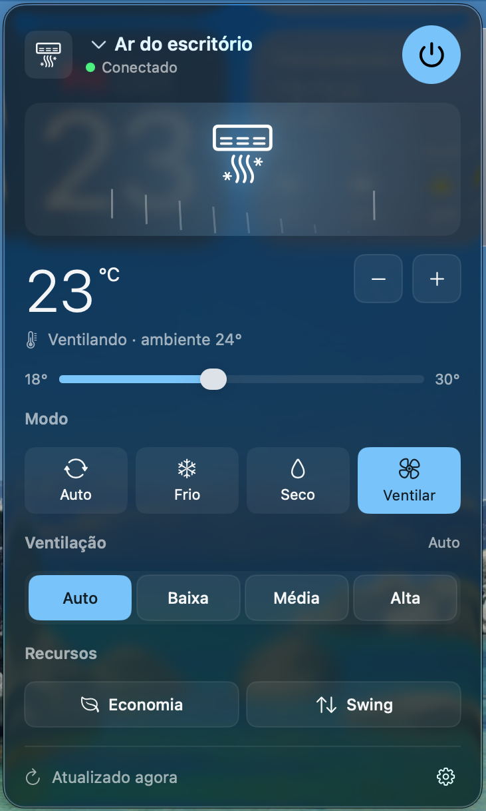

# ArLG — controle seu ar-condicionado LG pela barra de menu do Mac

App nativo em SwiftUI que fica na barra de menu do macOS e controla aparelhos de ar-condicionado LG conectados ao app **LG ThinQ**, usando a API oficial **ThinQ Connect**.

<p align="center"></p>

## Recursos

- Ícone na barra de menu (floco de neve + temperatura alvo quando ligado)
- Painel com seletor de aparelho (suporta qualquer número de ares da conta)
- Liga/desliga, temperatura alvo (botões −/+ e slider, passo 0,5°)
- Modos (Auto, Frio, Seco, Ventilar, Quente — só os que o aparelho suporta)
- Ventilação (Auto, Baixa, Média, Alta)
- Recursos: Economia de energia e Swing, quando suportados
- Último estado salvo em disco, atualização a cada 3 min com backoff em caso de limite da API
- Abrir ao iniciar sessão (menu de engrenagem)

## Requisitos

- macOS 14 (Sonoma) ou mais novo
- Swift toolchain: Xcode ou Command Line Tools (`xcode-select --install`)
- Python 3 (`python3 --version`)
- Ar-condicionado já cadastrado e funcionando no app **LG ThinQ** (Wi-Fi)

## 1. Obtendo o Personal Access Token (PAT) da LG

1. Acesse **https://connect-pat.lgthinq.com**.
2. Faça login com a **mesma conta LG** usada no app LG ThinQ.
3. Clique em **ADD NEW TOKEN**.
4. Dê um nome ao token (ex.: `ArLG Mac`).
5. Selecione **todas** as permissões/escopos (listar aparelhos, ver status, controlar aparelhos etc.).
6. Clique em **CREATE TOKEN**.
7. Copie o token gerado (guarde-o como senha; não compartilhe).

## 2. Configuração

O token é lido, nesta ordem:

1. variável de ambiente `LG_THINQ_PAT`;
2. arquivo indicado por `LG_THINQ_TOKEN_FILE`;
3. arquivo padrão `~/.config/lg-ac/token`.

Forma recomendada:

```bash
mkdir -p ~/.config/lg-ac && chmod 700 ~/.config/lg-ac
cp token.example ~/.config/lg-ac/token
nano ~/.config/lg-ac/token        # cole seu token no lugar do texto
chmod 600 ~/.config/lg-ac/token
```

Outras opções (variáveis de ambiente do helper):

| Variável | Padrão | Uso |
|---|---|---|
| `LG_THINQ_COUNTRY` | `BR` | Código do país da sua conta LG (ex.: `US`, `PT`) |
| `LG_THINQ_PAT` | — | Token direto via ambiente |
| `LG_THINQ_TOKEN_FILE` | `~/.config/lg-ac/token` | Caminho alternativo do token |
| `LG_AC_HOME` | `~/.config/lg-ac` | Pasta de config/cache |

> Apps abertos pelo Finder não herdam variáveis do terminal; para o app, use o arquivo de token. Se precisar mudar o país, edite o padrão em `helper/lgac.py` antes de instalar.

## 3. Instalação

```bash
git clone https://github.com/rgielow/arlg-mac.git
cd arlg-mac
./install.sh
```

O script cria um venv em `~/.config/lg-ac/venv`, instala `thinqconnect`, copia o helper, compila o app com `swiftc`, assina ad-hoc e instala em `~/Applications/ArLG.app`, abrindo em seguida.

Teste o helper pelo terminal:

```bash
~/.config/lg-ac/venv/bin/python ~/.config/lg-ac/lgac.py status
```

## 4. Uso

- Clique no floco de neve na barra de menu para abrir o painel.
- Para abrir ao iniciar sessão: engrenagem → **Abrir ao iniciar sessão**.
- Comandos do helper: `status`, `refresh-devices`, `power ID on|off`, `temp ID +|-|valor`, `mode ID MODO`, `fan ID VELOCIDADE`, `save ID on|off`, `swing ID on|off`.

## Limite da API LG

A LG limita chamadas por usuário. Ao exceder, a API retorna `UNKNOWN_ERROR (1314) – Exceeded User API calls`. Para evitar:

- A lista de aparelhos e perfis é guardada em `~/.config/lg-ac/devices.json` (só refeita com `refresh-devices`).
- O status é consultado a cada **3 min** e ~3 s após uma ação.
- Em caso de limite, o app espera 5, 10, 20, 40… min (máx. 60) e mostra _"Limite da LG atingido, tentando de novo às HH:MM"_.

## Solução de problemas

- **"Conectando…" ou erro no painel**: rode o helper `status` no terminal e veja a mensagem.
- **Token inválido / 401**: gere um novo token e substitua `~/.config/lg-ac/token`.
- **Nenhum aparelho**: confira o país (`LG_THINQ_COUNTRY`) e se o ar aparece no app LG ThinQ; depois `lgac.py refresh-devices`.
- **Adicionou/renomeou um aparelho**: `lgac.py refresh-devices`.
- **`xcrun: error`**: instale as Command Line Tools com `xcode-select --install`.
- **macOS bloqueia o app**: clique com o botão direito → Abrir, ou `xattr -dr com.apple.quarantine ~/Applications/ArLG.app`.

## Licença

MIT — veja [LICENSE](LICENSE).
